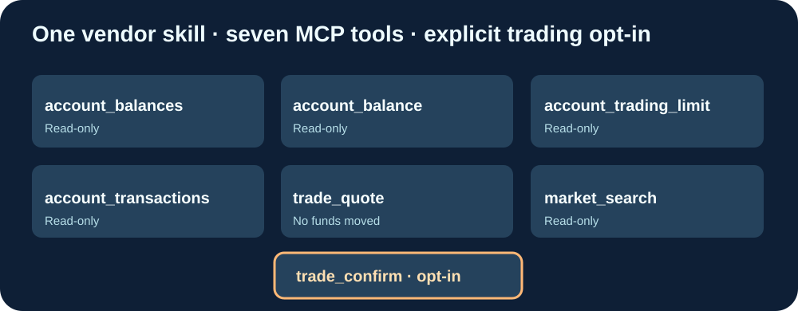

# Cloud9-CryptoComApp-MCP

**Sept outils MCP utilisant les scripts officiels Crypto.com App, avec image GHCR construite sur GitHub.**

[English](README.md) · Français · [简体中文](README.zh-CN.md)

Le dépôt officiel https://github.com/crypto-com/crypto-agent-trading contient les scripts métier TypeScript, **pas un serveur MCP distant**. Cloud9 fournit uniquement le petit pont HTTP/MCP ; la source fournisseur est récupérée sans modifications depuis le dernier commit vérifié à la construction. Il ne s'agit donc pas d'un fork du fournisseur.

## Fonctionnalités conservées

- account_balances, account_balance, account_trading_limit, account_transactions : consultations en lecture seule.
- trade_quote : préparation de cotation sans mouvement de fonds.
- market_search : recherche des actifs.
- trade_confirm : confirmation d'un ordre réel ; **désactivée par défaut**, annotation MCP destructive et activation explicite ALLOW_LIVE_TRADES=true uniquement dans un environnement privé.

Une confirmation de transaction demande aussi acknowledged=true et l'autorisation effective de l'utilisateur pour l'ordre précis. Ne pas exposer les identifiants de courtage ou l'API sur un port public.

## Distribution

GitHub Actions construit et teste l'image multiarchitecture ghcr.io/godsquantum/cloud9-cryptocomapp-mcp:latest, vérifie sept outils MCP et la désactivation des transactions par défaut. La machine de production fait seulement un Docker pull. Les clés ne sont jamais intégrées à l'image.

Installer : cloner https://github.com/GodsQuantum/Cloud9-CryptoComApp-MCP, copier .env.example en .env, renseigner uniquement les identifiants nécessaires puis lancer docker compose -f compose.example.yaml up -d. Endpoint privé : http://127.0.0.1:8185/mcp.

Pont MCP sous MIT ; scripts officiels du fournisseur Apache-2.0. Projet indépendant, sans affiliation Crypto.com.
