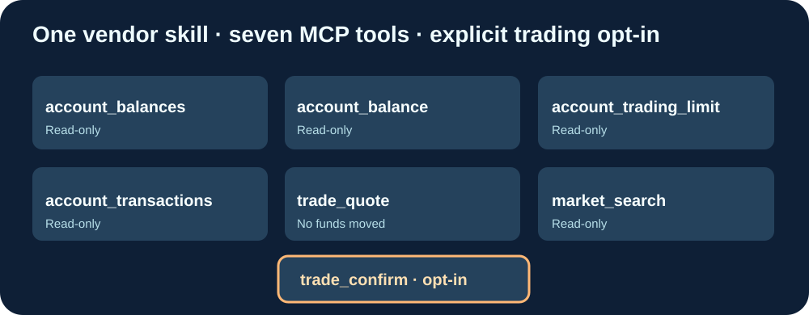

# Cloud9-CryptoComApp-MCP

**Seven MCP tools around the official Crypto.com App agent skill, prebuilt on GitHub and distributed through GHCR.**

English · [Français](README.fr.md) · [简体中文](README.zh-CN.md)

## Upstream versus Cloud9

- **Upstream:** https://github.com/crypto-com/crypto-agent-trading (Apache-2.0). The official Crypto.com App skill contains TypeScript scripts for accounts, quotations and trades. It does not provide a native remote MCP server.
- **Cloud9:** a small independently maintained TypeScript MCP/HTTP bridge. The upstream skill is downloaded verbatim at a verified vendor Git commit, never forked or patched. GitHub Actions resolves the current upstream main commit, builds multiarch images and checks existing tool contracts before publishing. No vendor code is copied into this repository.
- No credentials, accounts, tokens or personal IP addresses are shipped.

## Seven tools and safety

| Tool | Function |
|---|---|
| account_balances | Read portfolio balances |
| account_balance | Read a specific balance |
| account_trading_limit | Read account trading limits |
| account_transactions | Read transaction history |
| trade_quote | Obtain a quotation; **no funds moved** |
| market_search | Search supported market assets |
| trade_confirm | **Moves real funds**; explicitly destructive, denied by default |

**Live trade execution is disabled by default.** Only a trusted private deployment can set ALLOW_LIVE_TRADES=true, together with real broker credentials; the request must also include acknowledged=true. This option does not replace independent user authorization for each actual trade. Never expose a trading MCP to the public Internet without gateway authentication, permissions and auditing.

## Install

Clone https://github.com/GodsQuantum/Cloud9-CryptoComApp-MCP and copy .env.example to .env. Supply broker credentials only in that untracked file, secure the network, then run docker compose -f compose.example.yaml up -d. The MCP URL is http://127.0.0.1:8185/mcp; HTTP health is /healthz.

GHCR image: ghcr.io/godsquantum/cloud9-cryptocomapp-mcp:latest (built after GitHub CI tests). Routine updates only pull GHCR; no local git clone, npm install or Docker build. Immutable release tags retain rollback.

Wrapper code MIT; official vendor skill Apache-2.0 with preserved license. Third-party trademarks are used descriptively; not affiliated with or endorsed by Crypto.com.
