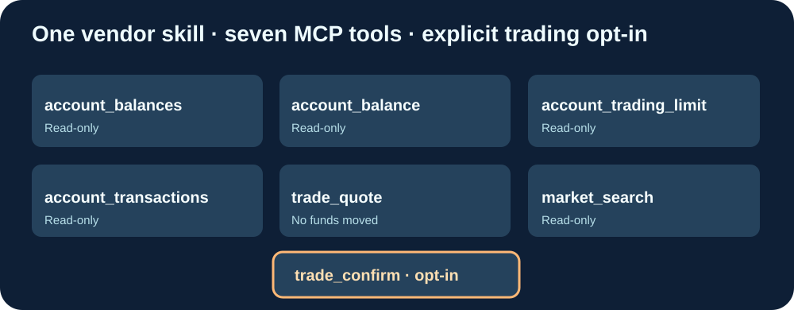

# Cloud9-CryptoComApp-MCP

**将 Crypto.com App 官方交易脚本连接至 MCP 的独立适配器，提供 GitHub 预编译 GHCR 镜像。**

[English](README.md) · [Français](README.fr.md) · 简体中文

上游 https://github.com/crypto-com/crypto-agent-trading 发布 TypeScript 交易脚本，但不提供相同的远程 MCP 服务。本项目只维护 HTTP/MCP 传输层，从上游指定的 Git SHA 获取未经修改的官方脚本，无需 fork 官方代码。

七个工具：account_balances、account_balance、account_trading_limit、account_transactions、market_search 属于只读查询；trade_quote 只生成报价；**trade_confirm 可转移真实资金**，因此默认禁用并标记为破坏性操作。只有受信任的私人部署配置 ALLOW_LIVE_TRADES=true 才可启用，并仍要求 acknowledged=true 与用户对具体交易的明确授权。

GitHub Actions 自动获取上游最新提交、构建和测试多架构镜像，只有七个工具的接口及默认交易防护全部通过才发布 ghcr.io/godsquantum/cloud9-cryptocomapp-mcp:latest。生产服务器仅需拉取镜像。

安装：克隆 https://github.com/GodsQuantum/Cloud9-CryptoComApp-MCP，复制 .env.example 为 .env，然后运行 docker compose -f compose.example.yaml up -d。MCP 地址 http://127.0.0.1:8185/mcp；不要将交易密钥或服务暴露到公开网络。

包装代码采用 MIT，官方供应商源码保留 Apache-2.0 授权。本项目与 Crypto.com 无官方关联。
